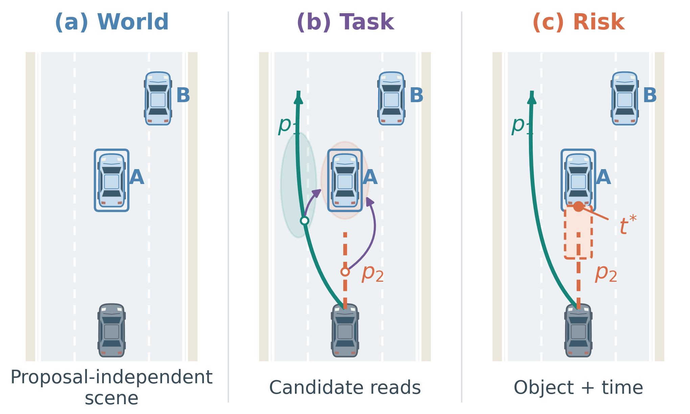

# WTR-Drive

**World–Task Decomposition with Structured Risk Supervision for End-to-End Driving**

Haoyu Xing, Shaobing Ding, Guanglei Zhao, Guanhua Zhao, Nawu Peng, and Mingyang Hou

Voyah Automotive Technology Co., Ltd.

WTR-Drive is an end-to-end driving planner built on Drive-JEPA. It separates a shared, proposal-independent World Memory from proposal-conditioned Task Memory and introduces structured risk supervision for event existence, object association, and first violation time.

[Overview](#method-overview) · [Results](#reported-results) · [Installation](docs/installation.md) · [Usage](docs/usage.md) · [Reproduction](docs/reproduction.md) · [FAQ](docs/faq.md) · [Model repository](https://huggingface.co/Xinghaoyu/WTR-Drive)

## Release status

**Code will be released after paper acceptance.** This preview contains project information, a concept figure, and documentation. Training and evaluation commands describe the prepared source package and require that package to run.

| Item | Status |
|---|---|
| Source code and experiment configurations | Public release after paper acceptance |
| Model weights | Stored in [Xinghaoyu/WTR-Drive](https://huggingface.co/Xinghaoyu/WTR-Drive); currently private |
| Installation and usage documentation | Preview provided here |
| World–Task–Risk concept figure | Included below |
| WTR-Drive demo video | Not yet prepared |

## Method overview



**World–Task–Risk formulation.** (a) All candidates share one scene estimate. (b) Candidates p₁ (teal, solid) and p₂ (orange, dashed) read the shared Task Memory. (c) Only p₂ collides with object A at t*; the orange footprint marks the ego vehicle at first contact. This is a conceptual illustration.

- **World Memory:** estimates objects, map structure, and object motion from observations and is re-read at each refinement round. Proposal feedback never writes back to it.
- **Task Memory:** carries residual task information through candidate-specific reads, gated visual feedback, and the scoring readout.
- **Structured risk supervision:** derives object and time targets from the rollouts already computed for candidate scoring, without additional simulator calls.

## Reported results

| Benchmark | Metric ↑ | WTR-Drive |
|---|---|---:|
| NAVSIM v1 navtest | PDMS | **94.66** |
| NAVSIM v2 navtest | EPDMS | **88.24** |

Scores are on a 0–100 scale and come from single-seed runs (seed 0), with 12,146 non-missing expert-scene records per version. The v2 result uses expert-frame sequential evaluation without HPF correction; it does not measure full two-stage pseudo-closed-loop performance. These values come from the original formal evaluations, not a new benchmark run of the release package. See [reproduction details](docs/reproduction.md).

## Installation, usage, and weights

The [installation guide](docs/installation.md) describes the reference software stack and data requirements. The [usage guide](docs/usage.md) previews evaluation and training commands for the future source release.

Weights are hosted in the **private** repository [Xinghaoyu/WTR-Drive](https://huggingface.co/Xinghaoyu/WTR-Drive). With an account already authorized to access it:

```bash
hf auth login
hf download Xinghaoyu/WTR-Drive --local-dir ./weights
```

The package contains NAVSIM v1/v2 inference checkpoints and their matching configurations. Weights alone do not include the planner source, dataset, or upstream visual-encoder initialization checkpoint. See [usage and download details](docs/usage.md).

## Acknowledgments

We thank the authors of [Drive-JEPA](https://github.com/linhanwang/Drive-JEPA), [NAVSIM](https://github.com/autonomousvision/navsim), [iPad](https://github.com/Kguo-cs/iPad), and [V-JEPA 2](https://github.com/facebookresearch/vjepa2) for their public implementations and research. WTR-Drive builds on their planning, evaluation, and video-representation components.

## Contact

For research questions or feedback, contact the corresponding author, **Haoyu Xing**, at [17843105684@163.com](mailto:17843105684@163.com).
